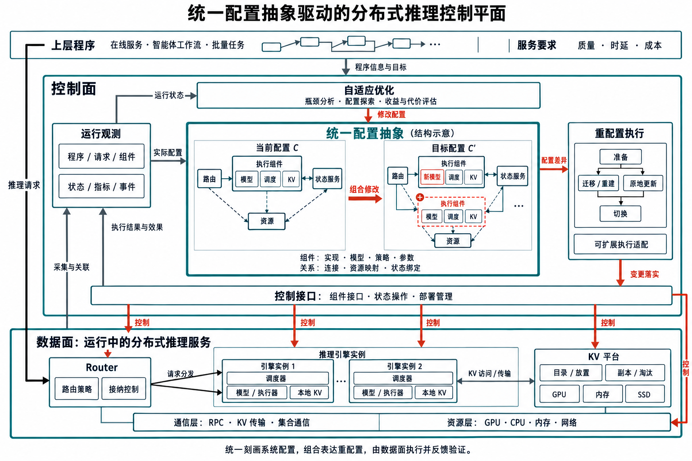

# RIDE

**A programmable control plane for evolving inference.**

分布式推理服务的可编程控制面。

[Website](https://yancanmao.github.io/ride-website/) · [RIDE framework](https://github.com/vLLM-HUST/ride) · [Build a controller](https://github.com/vLLM-HUST/ride-controller-demo) · [Implementation & evidence](https://yancanmao.github.io/ride-website/docs/controllers.html)

Workloads change. Serving configurations should adapt. RIDE's research vision is to connect program behavior, runtime state, and system configuration, so a distributed inference service can adapt as a whole.

控制对象不止请求或几个参数：组件、实现、模型、策略、连接、并行组织，以及资源与状态绑定，都可以进入配置与重配置的研究范围。当前工程从独立 Controller 入手，逐步验证协作。

## Architecture / 系统架构

[Architecture page](https://yancanmao.github.io/ride-website/docs/architecture.html) · [Editable draw.io](assets/architecture/bundle/ride-architecture.drawio) · [Structured source](assets/architecture/ride-architecture.json)

Ray 承载分布式进程、资源调度与执行观测；RIDE 管部署、身份与生命周期；独立 Controller 执行运行时循环。业务请求、控制动作、观测反馈分列。六类基础能力已纳入67项本地检查，新增云端和真实设备资格另验；配置选择只建议，放置不是资源预约。

## The vision / 研究愿景

1. **Cross-layer diagnosis / 跨层瓶颈分析** — associate programs, requests, batches, engines, KV, communication, and resources; explain what actually constrains service performance.
2. **Configuration exploration / 配置探索** — compare components, policies, models, connections, and bindings under application and system constraints.
3. **Stateful online reconfiguration / 有状态在线重配置** — account for loading, transfer, recomputation, cache rebuilding, drain, and disruption when deciding whether, when, and how to change.



Original concept from Yancan Mao's research materials, 2026-09-14; reused unchanged. This is a research blueprint, not a claim that the whole architecture is implemented.

## Independent controllers / 独立 Controller

| Controller | What it controls | Coordination |
| --- | --- | --- |
| **Request Throttling** | Request waiting, concurrency, and multi-turn program affinity | Connect execution placement to KV locality; finish existing programs before stopping a replica |
| **KV Management** | Existing cross-instance CPU KV prefix copies through native LMCache | Verify source/destination coverage; unresolved effects block drain completion |
| **Instance Autoscaling** | Model processes and Ray resource reservations through RIDE | Route after readiness; drain programs and KV operations before exact-job stop |

These are initial implementations, not the boundary of the research scope. RIDE manages independent packages through a common plugin and lifecycle interface. The management API is not on the model request path.

## What exists / 当前状态

Reviewed **2026-11-05**, cooperative implementation revision `5cdb496`:

- Prior version: three policy controllers and one native LMCache registry backend passed cloud CPU lifecycle validation (44 checks).
- Replay adapter and missing-worker observation correction: 54 local checks, CLI, and build pass; those additions are not cloud-validated.
- Real-model requests for the cooperative package: **0**. Physical KV copy, actual model scaling, and full-batch benefit remain unaccepted.
- Existing Request Throttling and the new cooperative request controller are distinct implementations.
- Stopping model jobs does **not** automatically reduce platform NPU allocations.

[Detailed scope and evidence notes](docs/controllers.html). Controller implementation repositories currently require access; this website does not change their visibility. RIDE and the controller starter are public.

## Website development

Buildless HTML/CSS/JavaScript, bilingual EN/中文, local assets, no analytics or live infrastructure connection.

```sh
python3 tools/check_site.py
python3 -m http.server 8765 --bind 127.0.0.1
```

GitHub Pages publishes `main` from `/`; `.nojekyll` keeps this a static site. Figure source and exact hashes: [assets/PROVENANCE.json](assets/PROVENANCE.json). No private raw logs, credentials, or platform identifiers belong in this repository.

Maintained by [Yancan Mao / 毛言粲](https://github.com/yancanmao).
